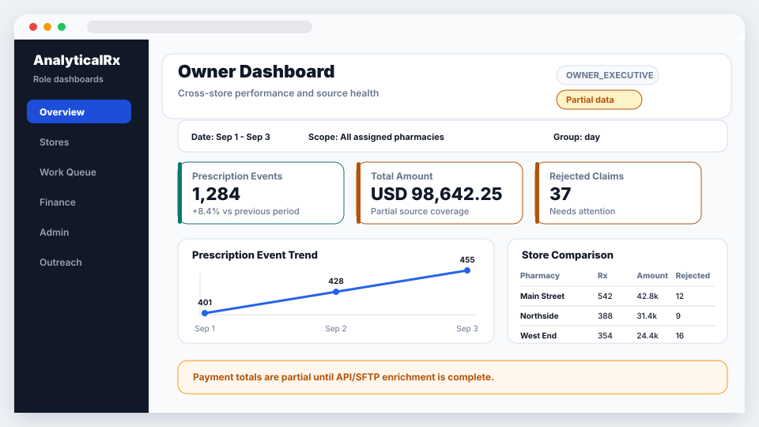
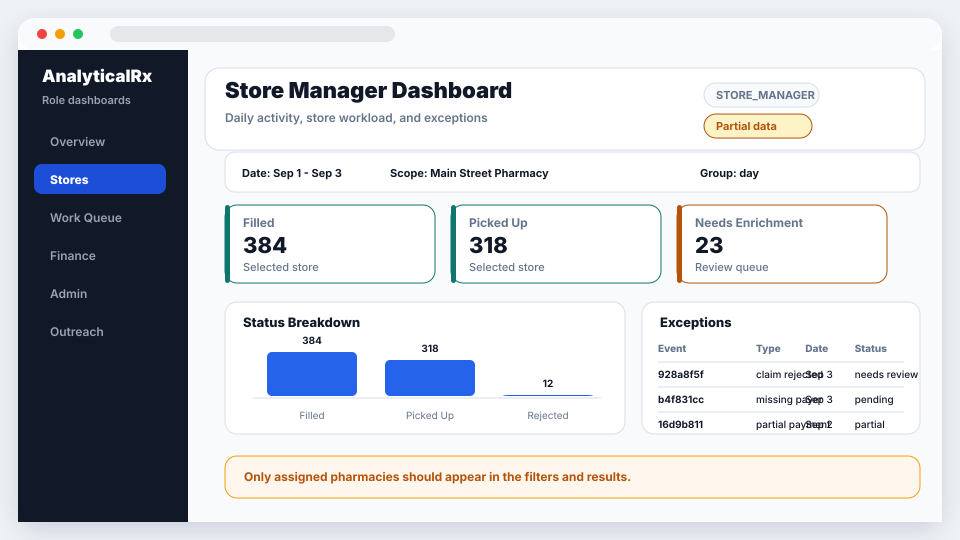
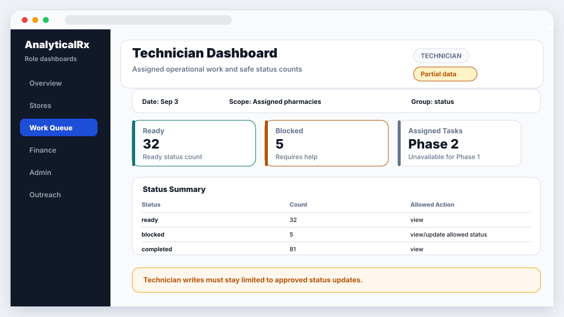
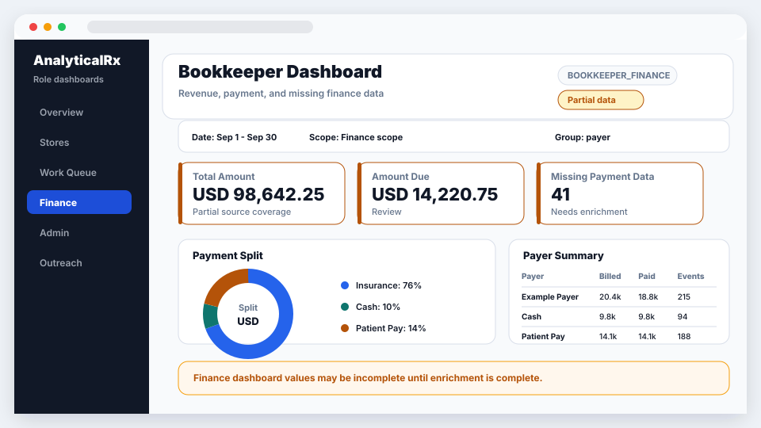
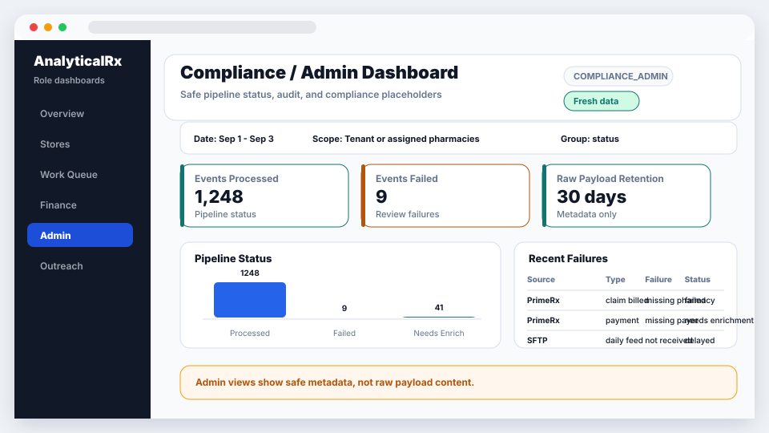
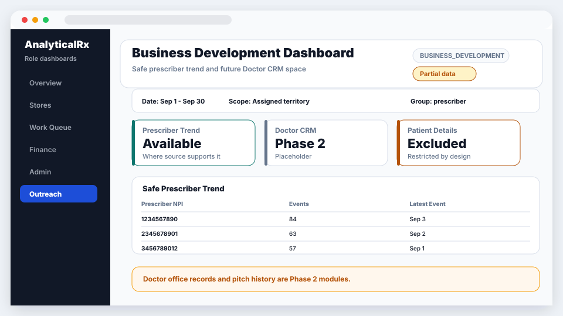

# AnalyticalRx UI API Contracts

Status: Initial draft for UI/backend review

Audience: frontend engineer, backend engineer, QA
Primary source documents:

- `prd/product-requirements-document.md`
- `architecture/data-platform-service-design.md`
- `architecture/role-based-access-control-standard.md`
- `architecture/rbac-role-summary.md`

## 1. Purpose

This document defines the initial API contracts the frontend can integrate against for Phase 1.

Phase 1 scope:

- username/password login
- JWT bearer authentication
- current user/role/tenant context
- tenant and pharmacy lookup
- starter dashboards for all Phase 1 roles
- tenant admin user/role screens
- internal platform admin screens
- pipeline and permission audit summaries

These contracts are intentionally UI-facing. They should not expose database table names, raw PrimeRx payloads, real `RxNo`, real `RefillNo`, direct patient identifiers, raw source API responses, or database schema names.

## 2. General API Rules

Base path:

```text
/api/v1
```

Content type:

```text
application/json
```

Authentication:

```text
Authorization: Bearer <accessToken>
```

Conventions:

- JSON fields use `camelCase`.
- Date fields use `YYYY-MM-DD`.
- Date/time fields use ISO-8601 UTC timestamps.
- IDs returned to the frontend are opaque strings, usually UUIDs.
- `tenantKey` is a stable slug, for example `analyticalrx-dev`.
- The frontend must not send or store database schema names.
- The backend must resolve tenant schema from trusted server-side control-plane data.
- Empty and partial-data states are normal in Phase 1 while source feeds are still being finalized.

## 3. Common Error Contract

All non-2xx errors should return this shape.

```json
{
  "error": {
    "code": "FORBIDDEN",
    "message": "You do not have access to this resource.",
    "requestId": "req_01HZY8Q9QVR4X8XQZJ2NQ9Y3A1",
    "details": []
  }
}
```

Recommended status codes:

| Status | Meaning |
| --- | --- |
| `400` | Invalid request, invalid filter, invalid date range, malformed body. |
| `401` | Missing, expired, or invalid token. |
| `403` | Authenticated user does not have the required tenant, pharmacy, or role access. |
| `404` | Resource not found or intentionally hidden from this user. |
| `409` | Duplicate or conflicting write request. |
| `422` | Valid JSON but business validation failed. |
| `429` | Rate limited. |
| `500` | Unexpected server error. |
| `503` | Dependency unavailable, for example database or source status service. |

## 4. Common List Contract

List APIs should use this shape unless the endpoint defines a more specific response.

```json
{
  "items": [],
  "page": {
    "pageNumber": 1,
    "pageSize": 25,
    "totalItems": 0,
    "totalPages": 0
  }
}
```

Common query parameters:

| Parameter | Type | Required | Meaning |
| --- | --- | --- | --- |
| `page` | integer | No | 1-based page number. Default `1`. |
| `pageSize` | integer | No | Page size. Default `25`. Suggested max `100`. |
| `search` | string | No | Safe search text for list views. |
| `status` | string | No | Filter by status where supported. |
| `sort` | string | No | Field sort, for example `displayName` or `-createdAt`. |

## 5. Common Dashboard Contract

All Phase 1 dashboard APIs should return the same outer response shape so the frontend can render reusable cards, charts, tables, warnings, empty states, and partial-data states.

Dashboard query parameters:

| Parameter | Type | Required | Meaning |
| --- | --- | --- | --- |
| `startDate` | date | No | Inclusive start date. Backend default should be a sensible recent period, for example last 30 days. |
| `endDate` | date | No | Inclusive end date. Backend default should be today. |
| `pharmacyIds` | comma-separated string | No | Optional pharmacy IDs. Backend must intersect with user's allowed pharmacies. |
| `groupBy` | string | No | Supported values depend on dashboard, for example `day`, `week`, `month`, `store`, `drug`, `payer`, `status`. |
| `status` | string | No | Optional status filter where supported. |

Generic dashboard response:

```json
{
  "dashboardId": "owner",
  "title": "Owner Dashboard",
  "tenantKey": "analyticalrx-dev",
  "generatedAt": "2026-09-03T10:30:00Z",
  "filters": {
    "startDate": "2026-09-01",
    "endDate": "2026-09-03",
    "pharmacyIds": [],
    "groupBy": "day"
  },
  "dataFreshness": {
    "latestEventAt": "2026-09-03T09:55:00Z",
    "status": "partial",
    "message": "Some payment fields are still pending enrichment."
  },
  "cards": [],
  "charts": [],
  "tables": [],
  "warnings": []
}
```

Card model:

```json
{
  "id": "totalPrescriptionEvents",
  "title": "Prescription Events",
  "value": 1284,
  "valueType": "number",
  "unit": null,
  "currency": null,
  "trend": {
    "direction": "up",
    "percent": 8.4,
    "label": "vs previous period"
  },
  "status": "ok",
  "emptyState": null
}
```

Chart model:

```json
{
  "id": "eventTrend",
  "title": "Event Trend",
  "type": "line",
  "xAxis": {
    "field": "date",
    "label": "Date"
  },
  "yAxis": {
    "field": "count",
    "label": "Events"
  },
  "series": [
    {
      "name": "Filled",
      "data": [
        { "date": "2026-09-01", "count": 340 },
        { "date": "2026-09-02", "count": 388 }
      ]
    }
  ]
}
```

Table model:

```json
{
  "id": "storePerformance",
  "title": "Store Performance",
  "columns": [
    { "key": "pharmacyName", "label": "Pharmacy", "type": "text" },
    { "key": "prescriptionEvents", "label": "Rx Events", "type": "number" },
    { "key": "totalAmount", "label": "Total Amount", "type": "currency" },
    { "key": "dataQualityStatus", "label": "Data Quality", "type": "status" }
  ],
  "rows": [
    {
      "pharmacyId": "3d4b55ae-7120-42b7-aef8-8cc3fb839d3f",
      "pharmacyName": "Main Street Pharmacy",
      "prescriptionEvents": 542,
      "totalAmount": 42810.55,
      "dataQualityStatus": "partial"
    }
  ],
  "emptyState": null
}
```

Warning model:

```json
{
  "code": "PARTIAL_PAYMENT_DATA",
  "severity": "warning",
  "message": "Payment totals may be incomplete until API/SFTP enrichment is complete."
}
```

Allowed `valueType` values:

```text
number, currency, percent, text, date, datetime, status
```

Allowed dashboard freshness statuses:

```text
fresh, partial, delayed, unavailable
```

### Dashboard Response To UI Placement

Use this mapping for all starter dashboards.

| API field | UI placement | Notes |
| --- | --- | --- |
| `dashboardId` | Internal route/component key | Do not display directly unless useful for debugging. |
| `title` | Page heading | Example: `Owner Dashboard`. |
| `tenantKey` | Tenant selector context | Display tenant name from `/me` or `/tenants` when available. |
| `generatedAt` | Small timestamp in header or freshness tooltip | Useful for support and refresh behavior. |
| `filters.startDate`, `filters.endDate` | Date range control | Frontend sends selected values back on refresh. |
| `filters.pharmacyIds` | Pharmacy filter control | Backend must still enforce assigned pharmacy scope. |
| `filters.groupBy` | Grouping selector where supported | Hide or disable if dashboard does not support grouping. |
| `dataFreshness.status` | Header status pill | Use visual states for `fresh`, `partial`, `delayed`, and `unavailable`. |
| `dataFreshness.message` | Inline message or tooltip near freshness pill | Keep visible when status is not `fresh`. |
| `cards[]` | Top KPI card row | `valueType`, `currency`, `unit`, `trend`, `status`, and `emptyState` drive card formatting. |
| `charts[]` | Main chart panels | Use `type`, `series`, `xAxis`, and `yAxis`. |
| `tables[]` | Main table panels | Use `columns[]` to render headers and cell formatting. |
| `warnings[]` | Alert strip above or below content | Use `severity` for color. Never show raw PHI in warning text. |
| `emptyState` | Same location as the missing card/chart/table | Do not remove the UI section entirely if the product expects a placeholder. |

## 6. Authentication APIs

### `POST /api/v1/auth/login`

Purpose: Sign in with username/email and password and return a JWT bearer token.

Auth: Public

Request:

```json
{
  "email": "owner@example.com",
  "password": "example-password"
}
```

Response:

```json
{
  "accessToken": "eyJhbGciOiJIUzI1NiIsInR5cCI6IkpXVCJ9...",
  "tokenType": "Bearer",
  "expiresInSeconds": 1800,
  "issuedAt": "2026-09-03T10:00:00Z",
  "user": {
    "id": "f34635ae-9fa6-4d5f-9dcf-0a2a76d0c3d3",
    "email": "owner@example.com",
    "displayName": "Owner User",
    "status": "active"
  }
}
```

UI behavior:

- Store token according to the frontend security decision.
- Send token in `Authorization` header for all protected APIs.
- Call `GET /api/v1/me` after login to build navigation and tenant context.

### `POST /api/v1/auth/logout`

Purpose: Record logout or revoke token ID if denylist support is implemented.

Auth: Authenticated user

Request:

```json
{}
```

Response:

```json
{
  "status": "logged_out"
}
```

### `GET /api/v1/me`

Purpose: Return the current user, tenants, roles, allowed pharmacies, and navigation capabilities.

Auth: Authenticated user

Response:

```json
{
  "user": {
    "id": "f34635ae-9fa6-4d5f-9dcf-0a2a76d0c3d3",
    "email": "owner@example.com",
    "displayName": "Owner User",
    "status": "active"
  },
  "tenants": [
    {
      "tenantKey": "analyticalrx-dev",
      "displayName": "AnalyticalRx Dev Tenant",
      "roles": ["OWNER_EXECUTIVE", "TENANT_ADMIN"],
      "pharmacyScope": "all_pharmacies",
      "pharmacyIds": [],
      "capabilities": [
        "dashboard.owner.read",
        "dashboard.compliance.read",
        "tenant.users.read",
        "tenant.roles.read"
      ]
    }
  ],
  "internalRoles": [],
  "navigation": [
    {
      "id": "owner-dashboard",
      "label": "Owner",
      "path": "/tenants/analyticalrx-dev/dashboards/owner",
      "requiredCapability": "dashboard.owner.read"
    }
  ],
  "permissionsVersion": 1
}
```

UI behavior:

- Use this response to build the navigation menu.
- Do not hardcode role-to-menu assumptions in the frontend.
- If the selected tenant changes, call tenant/pharmacy/dashboard APIs for the selected `tenantKey`.

## 7. Tenant And Pharmacy APIs

### `GET /api/v1/tenants`

Purpose: Return tenants visible to the current user.

Auth: Authenticated user

Response:

```json
{
  "items": [
    {
      "tenantKey": "analyticalrx-dev",
      "displayName": "AnalyticalRx Dev Tenant",
      "status": "active",
      "roles": ["OWNER_EXECUTIVE"],
      "pharmacyScope": "all_pharmacies"
    }
  ]
}
```

### `GET /api/v1/tenants/{tenantKey}/pharmacies`

Purpose: Return pharmacies visible to the current user for a tenant.

Auth: Any tenant-assigned role

Example:

```text
GET /api/v1/tenants/analyticalrx-dev/pharmacies?status=active
```

Response:

```json
{
  "items": [
    {
      "id": "3d4b55ae-7120-42b7-aef8-8cc3fb839d3f",
      "pharmacyKey": "main-street",
      "displayName": "Main Street Pharmacy",
      "stateCode": "TX",
      "status": "active"
    }
  ]
}
```

## 8. Phase 1 Dashboard APIs

All dashboard APIs use the common dashboard query and response contract from Section 5.

### Dashboard Endpoint Summary

| Dashboard | API | Allowed roles |
| --- | --- | --- |
| Owner / Executive | `GET /api/v1/tenants/{tenantKey}/dashboards/owner` | `OWNER_EXECUTIVE` |
| Store Manager | `GET /api/v1/tenants/{tenantKey}/dashboards/store-manager` | `STORE_MANAGER`, `OWNER_EXECUTIVE` |
| Pharmacist | `GET /api/v1/tenants/{tenantKey}/dashboards/pharmacist` | `PHARMACIST`, `STORE_MANAGER`, `OWNER_EXECUTIVE` |
| Technician | `GET /api/v1/tenants/{tenantKey}/dashboards/technician` | `TECHNICIAN`, `PHARMACIST`, `STORE_MANAGER` |
| Bookkeeper / Finance | `GET /api/v1/tenants/{tenantKey}/dashboards/bookkeeper` | `BOOKKEEPER_FINANCE`, `OWNER_EXECUTIVE` |
| Compliance / Admin | `GET /api/v1/tenants/{tenantKey}/dashboards/compliance-admin` | `COMPLIANCE_ADMIN`, `TENANT_ADMIN`, `OWNER_EXECUTIVE` |
| Business Development | `GET /api/v1/tenants/{tenantKey}/dashboards/business-development` | `BUSINESS_DEVELOPMENT`, `STORE_MANAGER`, `OWNER_EXECUTIVE` |

### Owner Dashboard

Example:

```text
GET /api/v1/tenants/analyticalrx-dev/dashboards/owner?startDate=2026-09-01&endDate=2026-09-03&groupBy=day
```

Recommended Phase 1 widgets:

- total prescription/fill event volume
- estimated revenue/payment total where available
- store comparison
- claim rejection/reversal counts where available
- ingestion/data freshness warning
- source/data quality exceptions

Dashboard mockup:



Sample response:

```json
{
  "dashboardId": "owner",
  "title": "Owner Dashboard",
  "tenantKey": "analyticalrx-dev",
  "generatedAt": "2026-09-03T10:30:00Z",
  "filters": {
    "startDate": "2026-09-01",
    "endDate": "2026-09-03",
    "pharmacyIds": [],
    "groupBy": "day"
  },
  "dataFreshness": {
    "latestEventAt": "2026-09-03T09:55:00Z",
    "status": "partial",
    "message": "Some payment fields are pending enrichment."
  },
  "cards": [
    {
      "id": "prescriptionEvents",
      "title": "Prescription Events",
      "value": 1284,
      "valueType": "number",
      "unit": null,
      "currency": null,
      "trend": { "direction": "up", "percent": 8.4, "label": "vs previous period" },
      "status": "ok",
      "emptyState": null
    },
    {
      "id": "totalAmount",
      "title": "Total Amount",
      "value": 98642.25,
      "valueType": "currency",
      "unit": null,
      "currency": "USD",
      "trend": null,
      "status": "partial",
      "emptyState": null
    },
    {
      "id": "rejectedClaims",
      "title": "Rejected Claims",
      "value": 37,
      "valueType": "number",
      "unit": null,
      "currency": null,
      "trend": null,
      "status": "warning",
      "emptyState": null
    }
  ],
  "charts": [
    {
      "id": "eventTrend",
      "title": "Prescription Event Trend",
      "type": "line",
      "xAxis": { "field": "date", "label": "Date" },
      "yAxis": { "field": "count", "label": "Events" },
      "series": [
        {
          "name": "Events",
          "data": [
            { "date": "2026-09-01", "count": 401 },
            { "date": "2026-09-02", "count": 428 },
            { "date": "2026-09-03", "count": 455 }
          ]
        }
      ]
    }
  ],
  "tables": [
    {
      "id": "storeComparison",
      "title": "Store Comparison",
      "columns": [
        { "key": "pharmacyName", "label": "Pharmacy", "type": "text" },
        { "key": "prescriptionEvents", "label": "Rx Events", "type": "number" },
        { "key": "totalAmount", "label": "Total Amount", "type": "currency" },
        { "key": "rejectedClaims", "label": "Rejected", "type": "number" },
        { "key": "dataQualityStatus", "label": "Data Quality", "type": "status" }
      ],
      "rows": [
        {
          "pharmacyId": "3d4b55ae-7120-42b7-aef8-8cc3fb839d3f",
          "pharmacyName": "Main Street Pharmacy",
          "prescriptionEvents": 542,
          "totalAmount": 42810.55,
          "rejectedClaims": 12,
          "dataQualityStatus": "partial"
        }
      ],
      "emptyState": null
    }
  ],
  "warnings": [
    {
      "code": "PARTIAL_PAYMENT_DATA",
      "severity": "warning",
      "message": "Payment totals may be incomplete until API/SFTP enrichment is complete."
    }
  ]
}
```

### Store Manager Dashboard

Example:

```text
GET /api/v1/tenants/analyticalrx-dev/dashboards/store-manager?startDate=2026-09-01&endDate=2026-09-03&pharmacyIds=3d4b55ae-7120-42b7-aef8-8cc3fb839d3f
```

Recommended Phase 1 widgets:

- selected-store event volume
- filled/picked-up/rejected/reversed counts where available
- payment totals where available
- enrichment-needed count
- failed/partial records requiring review

Dashboard mockup:



Sample response:

```json
{
  "dashboardId": "store-manager",
  "title": "Store Manager Dashboard",
  "tenantKey": "analyticalrx-dev",
  "generatedAt": "2026-09-03T10:30:00Z",
  "filters": {
    "startDate": "2026-09-01",
    "endDate": "2026-09-03",
    "pharmacyIds": ["3d4b55ae-7120-42b7-aef8-8cc3fb839d3f"],
    "groupBy": "day"
  },
  "dataFreshness": {
    "latestEventAt": "2026-09-03T09:55:00Z",
    "status": "partial",
    "message": null
  },
  "cards": [
    { "id": "filledEvents", "title": "Filled", "value": 384, "valueType": "number", "unit": null, "currency": null, "trend": null, "status": "ok", "emptyState": null },
    { "id": "pickedUpEvents", "title": "Picked Up", "value": 318, "valueType": "number", "unit": null, "currency": null, "trend": null, "status": "ok", "emptyState": null },
    { "id": "needsEnrichment", "title": "Needs Enrichment", "value": 23, "valueType": "number", "unit": null, "currency": null, "trend": null, "status": "warning", "emptyState": null }
  ],
  "charts": [
    {
      "id": "statusBreakdown",
      "title": "Status Breakdown",
      "type": "bar",
      "xAxis": { "field": "status", "label": "Status" },
      "yAxis": { "field": "count", "label": "Count" },
      "series": [
        {
          "name": "Events",
          "data": [
            { "status": "filled", "count": 384 },
            { "status": "picked_up", "count": 318 },
            { "status": "rejected", "count": 12 }
          ]
        }
      ]
    }
  ],
  "tables": [
    {
      "id": "exceptions",
      "title": "Exceptions",
      "columns": [
        { "key": "eventId", "label": "Event", "type": "text" },
        { "key": "eventType", "label": "Type", "type": "text" },
        { "key": "businessDate", "label": "Date", "type": "date" },
        { "key": "status", "label": "Status", "type": "status" }
      ],
      "rows": [
        {
          "eventId": "928a8f5f-810f-44fa-9cbf-40ce99fb4a93",
          "eventType": "claim_rejected",
          "businessDate": "2026-09-03",
          "status": "needs_review"
        }
      ],
      "emptyState": null
    }
  ],
  "warnings": []
}
```

### Pharmacist Dashboard

Example:

```text
GET /api/v1/tenants/analyticalrx-dev/dashboards/pharmacist?startDate=2026-09-03&endDate=2026-09-03
```

Recommended Phase 1 widgets:

- refill/fill events by status
- verification status counts where available
- blocked or rejected claim counts
- upcoming refill queue placeholder until Phase 2 workflow is built

Dashboard mockup:


Sample response:

```json
{
  "dashboardId": "pharmacist",
  "title": "Pharmacist Dashboard",
  "tenantKey": "analyticalrx-dev",
  "generatedAt": "2026-09-03T10:30:00Z",
  "filters": {
    "startDate": "2026-09-03",
    "endDate": "2026-09-03",
    "pharmacyIds": [],
    "groupBy": "status"
  },
  "dataFreshness": {
    "latestEventAt": "2026-09-03T09:55:00Z",
    "status": "partial",
    "message": "Workflow queue is planned for Phase 2."
  },
  "cards": [
    { "id": "verificationPending", "title": "Verification Pending", "value": 18, "valueType": "number", "unit": null, "currency": null, "trend": null, "status": "warning", "emptyState": null },
    { "id": "blockedClaims", "title": "Blocked Claims", "value": 7, "valueType": "number", "unit": null, "currency": null, "trend": null, "status": "warning", "emptyState": null },
    { "id": "upcomingRefills", "title": "Upcoming Refills", "value": null, "valueType": "number", "unit": null, "currency": null, "trend": null, "status": "unavailable", "emptyState": "Upcoming refill queue is planned for Phase 2." }
  ],
  "charts": [],
  "tables": [
    {
      "id": "workStatus",
      "title": "Work Status",
      "columns": [
        { "key": "status", "label": "Status", "type": "status" },
        { "key": "count", "label": "Count", "type": "number" }
      ],
      "rows": [
        { "status": "filled", "count": 44 },
        { "status": "verification_pending", "count": 18 },
        { "status": "blocked", "count": 7 }
      ],
      "emptyState": null
    }
  ],
  "warnings": []
}
```

### Technician Dashboard

Example:

```text
GET /api/v1/tenants/analyticalrx-dev/dashboards/technician?startDate=2026-09-03&endDate=2026-09-03
```

Recommended Phase 1 widgets:

- assigned work queue placeholder if task tables are not implemented yet
- fill status counts where available
- ready/blocked/completed summary where available
- compliance/fridge log placeholder based on Airtable reference

Dashboard mockup:



Sample response:

```json
{
  "dashboardId": "technician",
  "title": "Technician Dashboard",
  "tenantKey": "analyticalrx-dev",
  "generatedAt": "2026-09-03T10:30:00Z",
  "filters": {
    "startDate": "2026-09-03",
    "endDate": "2026-09-03",
    "pharmacyIds": [],
    "groupBy": "status"
  },
  "dataFreshness": {
    "latestEventAt": "2026-09-03T09:55:00Z",
    "status": "partial",
    "message": "Task workflow data is planned for Phase 2."
  },
  "cards": [
    { "id": "readyItems", "title": "Ready", "value": 32, "valueType": "number", "unit": null, "currency": null, "trend": null, "status": "ok", "emptyState": null },
    { "id": "blockedItems", "title": "Blocked", "value": 5, "valueType": "number", "unit": null, "currency": null, "trend": null, "status": "warning", "emptyState": null },
    { "id": "assignedTasks", "title": "Assigned Tasks", "value": null, "valueType": "number", "unit": null, "currency": null, "trend": null, "status": "unavailable", "emptyState": "Task queue is planned for Phase 2." }
  ],
  "charts": [],
  "tables": [
    {
      "id": "statusSummary",
      "title": "Status Summary",
      "columns": [
        { "key": "status", "label": "Status", "type": "status" },
        { "key": "count", "label": "Count", "type": "number" }
      ],
      "rows": [
        { "status": "ready", "count": 32 },
        { "status": "blocked", "count": 5 },
        { "status": "completed", "count": 81 }
      ],
      "emptyState": null
    }
  ],
  "warnings": []
}
```

### Bookkeeper / Finance Dashboard

Example:

```text
GET /api/v1/tenants/analyticalrx-dev/dashboards/bookkeeper?startDate=2026-09-01&endDate=2026-09-30&groupBy=payer
```

Recommended Phase 1 widgets:

- total amount, amount due, tax, discount, and other fee where available
- payer payment rows grouped by payment type and payer
- cash vs insurance payment split
- claim reversal/rejection counts
- missing/enrichment-needed payment data

Dashboard mockup:



Sample response:

```json
{
  "dashboardId": "bookkeeper",
  "title": "Bookkeeper Dashboard",
  "tenantKey": "analyticalrx-dev",
  "generatedAt": "2026-09-03T10:30:00Z",
  "filters": {
    "startDate": "2026-09-01",
    "endDate": "2026-09-30",
    "pharmacyIds": [],
    "groupBy": "payer"
  },
  "dataFreshness": {
    "latestEventAt": "2026-09-03T09:55:00Z",
    "status": "partial",
    "message": "Financial values are shown only where present in source data."
  },
  "cards": [
    { "id": "totalAmount", "title": "Total Amount", "value": 98642.25, "valueType": "currency", "unit": null, "currency": "USD", "trend": null, "status": "partial", "emptyState": null },
    { "id": "amountDue", "title": "Amount Due", "value": 14220.75, "valueType": "currency", "unit": null, "currency": "USD", "trend": null, "status": "warning", "emptyState": null },
    { "id": "missingPaymentData", "title": "Missing Payment Data", "value": 41, "valueType": "number", "unit": null, "currency": null, "trend": null, "status": "warning", "emptyState": null }
  ],
  "charts": [
    {
      "id": "paymentSplit",
      "title": "Payment Split",
      "type": "donut",
      "xAxis": null,
      "yAxis": null,
      "series": [
        {
          "name": "Payment Type",
          "data": [
            { "paymentType": "insurance", "amount": 74650.15 },
            { "paymentType": "cash", "amount": 9820.00 },
            { "paymentType": "patient_pay", "amount": 14172.10 }
          ]
        }
      ]
    }
  ],
  "tables": [
    {
      "id": "payerSummary",
      "title": "Payer Summary",
      "columns": [
        { "key": "payerName", "label": "Payer", "type": "text" },
        { "key": "billedAmount", "label": "Billed", "type": "currency" },
        { "key": "paidAmount", "label": "Paid", "type": "currency" },
        { "key": "eventCount", "label": "Events", "type": "number" }
      ],
      "rows": [
        {
          "payerId": "7dc492fd-e293-4be0-94c0-0d940ddff001",
          "payerName": "Example Payer",
          "billedAmount": 20420.25,
          "paidAmount": 18790.50,
          "eventCount": 215
        }
      ],
      "emptyState": null
    }
  ],
  "warnings": []
}
```

### Compliance / Admin Dashboard

Example:

```text
GET /api/v1/tenants/analyticalrx-dev/dashboards/compliance-admin?startDate=2026-09-01&endDate=2026-09-03
```

Recommended Phase 1 widgets:

- pipeline audit counts
- failed/retryable event counts
- raw payload retention status summary
- document/license placeholders from Airtable reference until those tables are implemented

Dashboard mockup:



Sample response:

```json
{
  "dashboardId": "compliance-admin",
  "title": "Compliance / Admin Dashboard",
  "tenantKey": "analyticalrx-dev",
  "generatedAt": "2026-09-03T10:30:00Z",
  "filters": {
    "startDate": "2026-09-01",
    "endDate": "2026-09-03",
    "pharmacyIds": [],
    "groupBy": "status"
  },
  "dataFreshness": {
    "latestEventAt": "2026-09-03T09:55:00Z",
    "status": "partial",
    "message": null
  },
  "cards": [
    { "id": "eventsProcessed", "title": "Events Processed", "value": 1248, "valueType": "number", "unit": null, "currency": null, "trend": null, "status": "ok", "emptyState": null },
    { "id": "eventsFailed", "title": "Events Failed", "value": 9, "valueType": "number", "unit": null, "currency": null, "trend": null, "status": "warning", "emptyState": null },
    { "id": "retentionWindowDays", "title": "Raw Payload Retention", "value": 30, "valueType": "number", "unit": "days", "currency": null, "trend": null, "status": "ok", "emptyState": null }
  ],
  "charts": [],
  "tables": [
    {
      "id": "pipelineStatus",
      "title": "Pipeline Status",
      "columns": [
        { "key": "status", "label": "Status", "type": "status" },
        { "key": "count", "label": "Count", "type": "number" }
      ],
      "rows": [
        { "status": "processed", "count": 1248 },
        { "status": "failed", "count": 9 },
        { "status": "needs_enrichment", "count": 41 }
      ],
      "emptyState": null
    }
  ],
  "warnings": []
}
```

### Business Development Dashboard

Example:

```text
GET /api/v1/tenants/analyticalrx-dev/dashboards/business-development?startDate=2026-09-01&endDate=2026-09-30
```

Recommended Phase 1 widgets:

- doctor CRM placeholder until CRM tables are implemented
- store/prescriber-level prescription trend only if safe and source data supports it
- no patient details

Dashboard mockup:



Sample response:

```json
{
  "dashboardId": "business-development",
  "title": "Business Development Dashboard",
  "tenantKey": "analyticalrx-dev",
  "generatedAt": "2026-09-03T10:30:00Z",
  "filters": {
    "startDate": "2026-09-01",
    "endDate": "2026-09-30",
    "pharmacyIds": [],
    "groupBy": "prescriber"
  },
  "dataFreshness": {
    "latestEventAt": "2026-09-03T09:55:00Z",
    "status": "partial",
    "message": "Doctor CRM workflows are planned for Phase 2."
  },
  "cards": [
    { "id": "prescriberTrendAvailable", "title": "Prescriber Trend", "value": "Available where source data supports it", "valueType": "text", "unit": null, "currency": null, "trend": null, "status": "partial", "emptyState": null },
    { "id": "doctorCrm", "title": "Doctor CRM", "value": null, "valueType": "number", "unit": null, "currency": null, "trend": null, "status": "unavailable", "emptyState": "Doctor CRM module is planned for Phase 2." }
  ],
  "charts": [],
  "tables": [
    {
      "id": "safePrescriberTrend",
      "title": "Safe Prescriber Trend",
      "columns": [
        { "key": "prescriberNpi", "label": "Prescriber NPI", "type": "text" },
        { "key": "eventCount", "label": "Events", "type": "number" },
        { "key": "latestEventDate", "label": "Latest Event", "type": "date" }
      ],
      "rows": [
        {
          "prescriberNpi": "1234567890",
          "eventCount": 84,
          "latestEventDate": "2026-09-03"
        }
      ],
      "emptyState": null
    }
  ],
  "warnings": [
    {
      "code": "NO_PATIENT_DETAILS",
      "severity": "info",
      "message": "Patient details are intentionally excluded from this dashboard."
    }
  ]
}
```

## 9. Tenant Admin APIs

Tenant admin APIs are for customer-side admins managing users, roles, tenant settings, pipeline visibility, and permission audit within their own tenant.

Allowed roles:

- `TENANT_ADMIN`
- `INTERNAL_PLATFORM_ADMIN` may access by internal policy

Rules:

- Tenant admins can manage only their own tenant.
- Tenant admins cannot assign `INTERNAL_PLATFORM_ADMIN`.
- Tenant admins cannot grant pharmacy scope outside their tenant.
- Every role assignment change must create a permission audit record.

### Tenant Admin Endpoint Summary

| Method | API | Purpose |
| --- | --- | --- |
| `GET` | `/api/v1/tenants/{tenantKey}/admin/users` | List tenant users. |
| `POST` | `/api/v1/tenants/{tenantKey}/admin/users` | Create tenant user. |
| `PATCH` | `/api/v1/tenants/{tenantKey}/admin/users/{userId}` | Update tenant user. |
| `GET` | `/api/v1/tenants/{tenantKey}/admin/roles` | List assignable customer roles. |
| `GET` | `/api/v1/tenants/{tenantKey}/admin/role-assignments` | List role assignments. |
| `POST` | `/api/v1/tenants/{tenantKey}/admin/role-assignments` | Create role assignment. |
| `DELETE` | `/api/v1/tenants/{tenantKey}/admin/role-assignments/{assignmentId}` | Deactivate role assignment. |
| `GET` | `/api/v1/tenants/{tenantKey}/admin/settings` | Read tenant settings. |
| `PATCH` | `/api/v1/tenants/{tenantKey}/admin/settings` | Update tenant settings. |
| `GET` | `/api/v1/tenants/{tenantKey}/admin/pipeline-audit` | Read tenant pipeline/import status. |
| `GET` | `/api/v1/tenants/{tenantKey}/admin/permission-audit` | Read tenant permission audit history. |

### `GET /api/v1/tenants/{tenantKey}/admin/users`

Example:

```text
GET /api/v1/tenants/analyticalrx-dev/admin/users?status=active&page=1&pageSize=25&search=owner
```

Response:

```json
{
  "items": [
    {
      "id": "f34635ae-9fa6-4d5f-9dcf-0a2a76d0c3d3",
      "email": "owner@example.com",
      "displayName": "Owner User",
      "status": "active",
      "roles": ["OWNER_EXECUTIVE"],
      "lastLoginAt": "2026-09-03T09:00:00Z"
    }
  ],
  "page": {
    "pageNumber": 1,
    "pageSize": 25,
    "totalItems": 1,
    "totalPages": 1
  }
}
```

### `POST /api/v1/tenants/{tenantKey}/admin/users`

Purpose: Create a tenant user.

Request:

```json
{
  "email": "manager@example.com",
  "displayName": "Store Manager",
  "temporaryPassword": "temporary-password",
  "status": "password_reset_required"
}
```

Response:

```json
{
  "id": "8b413e56-02ce-4781-87c7-dc54e4a78c9e",
  "email": "manager@example.com",
  "displayName": "Store Manager",
  "status": "password_reset_required",
  "createdAt": "2026-09-03T10:30:00Z"
}
```

### `PATCH /api/v1/tenants/{tenantKey}/admin/users/{userId}`

Purpose: Update display name or user status.

Request:

```json
{
  "displayName": "Store Manager Updated",
  "status": "active"
}
```

Response:

```json
{
  "id": "8b413e56-02ce-4781-87c7-dc54e4a78c9e",
  "email": "manager@example.com",
  "displayName": "Store Manager Updated",
  "status": "active",
  "updatedAt": "2026-09-03T10:40:00Z"
}
```

### `GET /api/v1/tenants/{tenantKey}/admin/roles`

Purpose: Return customer-facing roles that tenant admins can assign.

Response:

```json
{
  "items": [
    {
      "roleCode": "OWNER_EXECUTIVE",
      "displayName": "Owner / Executive",
      "description": "Tenant-level business owner or executive with cross-store visibility.",
      "roleLevel": "tenant",
      "allowedScopeTypes": ["tenant", "all_pharmacies", "selected_pharmacies"]
    },
    {
      "roleCode": "STORE_MANAGER",
      "displayName": "Store Manager",
      "description": "Pharmacy-level manager responsible for assigned store operations.",
      "roleLevel": "pharmacy",
      "allowedScopeTypes": ["all_pharmacies", "selected_pharmacies"]
    },
    {
      "roleCode": "PHARMACIST",
      "displayName": "Pharmacist",
      "description": "Pharmacy-level clinical and fulfillment workflow user.",
      "roleLevel": "pharmacy",
      "allowedScopeTypes": ["all_pharmacies", "selected_pharmacies"]
    },
    {
      "roleCode": "TECHNICIAN",
      "displayName": "Technician",
      "description": "Pharmacy-level operations user with limited workflow actions.",
      "roleLevel": "pharmacy",
      "allowedScopeTypes": ["all_pharmacies", "selected_pharmacies"]
    },
    {
      "roleCode": "BOOKKEEPER_FINANCE",
      "displayName": "Bookkeeper / Finance",
      "description": "Finance user for payment, revenue, reconciliation, and close visibility.",
      "roleLevel": "tenant",
      "allowedScopeTypes": ["tenant", "all_pharmacies", "selected_pharmacies"]
    },
    {
      "roleCode": "COMPLIANCE_ADMIN",
      "displayName": "Compliance Admin",
      "description": "Compliance user for documents, licenses, compliance status, and audit visibility.",
      "roleLevel": "tenant",
      "allowedScopeTypes": ["tenant", "all_pharmacies", "selected_pharmacies"]
    },
    {
      "roleCode": "BUSINESS_DEVELOPMENT",
      "displayName": "Business Development",
      "description": "Doctor office and relationship management user.",
      "roleLevel": "tenant",
      "allowedScopeTypes": ["tenant", "all_pharmacies", "selected_pharmacies"]
    },
    {
      "roleCode": "TENANT_ADMIN",
      "displayName": "Tenant Admin",
      "description": "Customer-side administrator for tenant users, role assignments, and tenant settings.",
      "roleLevel": "tenant",
      "allowedScopeTypes": ["tenant"]
    }
  ]
}
```

UI behavior:

- Use this response to populate role assignment dropdowns.
- Do not display `INTERNAL_PLATFORM_ADMIN` in tenant admin screens.
- Use `allowedScopeTypes` to decide whether to show pharmacy selection.

### `GET /api/v1/tenants/{tenantKey}/admin/role-assignments`

Example:

```text
GET /api/v1/tenants/analyticalrx-dev/admin/role-assignments?userId=8b413e56-02ce-4781-87c7-dc54e4a78c9e
```

Response:

```json
{
  "items": [
    {
      "id": "a6fb9883-b3bb-4d73-b16a-48633104d721",
      "userId": "8b413e56-02ce-4781-87c7-dc54e4a78c9e",
      "tenantKey": "analyticalrx-dev",
      "roleCode": "STORE_MANAGER",
      "scopeType": "selected_pharmacies",
      "pharmacyIds": ["3d4b55ae-7120-42b7-aef8-8cc3fb839d3f"],
      "status": "active",
      "effectiveFrom": "2026-09-03T10:30:00Z",
      "effectiveUntil": null
    }
  ]
}
```

### `POST /api/v1/tenants/{tenantKey}/admin/role-assignments`

Request:

```json
{
  "userId": "8b413e56-02ce-4781-87c7-dc54e4a78c9e",
  "roleCode": "STORE_MANAGER",
  "scopeType": "selected_pharmacies",
  "pharmacyIds": ["3d4b55ae-7120-42b7-aef8-8cc3fb839d3f"],
  "reason": "Assign manager to Main Street Pharmacy."
}
```

Response:

```json
{
  "id": "a6fb9883-b3bb-4d73-b16a-48633104d721",
  "userId": "8b413e56-02ce-4781-87c7-dc54e4a78c9e",
  "tenantKey": "analyticalrx-dev",
  "roleCode": "STORE_MANAGER",
  "scopeType": "selected_pharmacies",
  "pharmacyIds": ["3d4b55ae-7120-42b7-aef8-8cc3fb839d3f"],
  "status": "active",
  "createdAt": "2026-09-03T10:30:00Z"
}
```

### `DELETE /api/v1/tenants/{tenantKey}/admin/role-assignments/{assignmentId}`

Purpose: Deactivate a role assignment.

Request:

```json
{
  "reason": "User no longer manages this pharmacy."
}
```

Response:

```json
{
  "id": "a6fb9883-b3bb-4d73-b16a-48633104d721",
  "status": "inactive",
  "updatedAt": "2026-09-03T11:00:00Z"
}
```

### `GET /api/v1/tenants/{tenantKey}/admin/settings`

Purpose: Read tenant-level settings needed by admin UI.

Response:

```json
{
  "tenantKey": "analyticalrx-dev",
  "settings": {
    "timezone": "America/Chicago",
    "dashboardDefaultDateRangeDays": 30,
    "emailEnabled": false,
    "workflowAutomationEnabled": false
  },
  "updatedAt": "2026-09-03T10:30:00Z"
}
```

### `PATCH /api/v1/tenants/{tenantKey}/admin/settings`

Purpose: Update tenant-level settings.

Request:

```json
{
  "timezone": "America/Chicago",
  "dashboardDefaultDateRangeDays": 30
}
```

Response:

```json
{
  "tenantKey": "analyticalrx-dev",
  "settings": {
    "timezone": "America/Chicago",
    "dashboardDefaultDateRangeDays": 30,
    "emailEnabled": false,
    "workflowAutomationEnabled": false
  },
  "updatedAt": "2026-09-03T10:45:00Z"
}
```

Note: `emailEnabled` and `workflowAutomationEnabled` are shown for future compatibility. They should remain disabled unless explicitly implemented and approved.

### `GET /api/v1/tenants/{tenantKey}/admin/pipeline-audit`

Purpose: Show safe ingestion/import status counts for the tenant.

Example:

```text
GET /api/v1/tenants/analyticalrx-dev/admin/pipeline-audit?startDate=2026-09-01&endDate=2026-09-03&status=failed
```

Response:

```json
{
  "tenantKey": "analyticalrx-dev",
  "generatedAt": "2026-09-03T10:30:00Z",
  "summary": {
    "received": 1320,
    "processed": 1248,
    "failed": 9,
    "duplicate": 22,
    "needsEnrichment": 41
  },
  "latestEventAt": "2026-09-03T09:55:00Z",
  "recentFailures": [
    {
      "ingestionEventId": "d731b68c-d4ee-40ad-917e-134599d67ff8",
      "sourceSystem": "primerx",
      "sourceEventType": "claim_billed",
      "receivedAt": "2026-09-03T09:20:00Z",
      "failureCode": "MISSING_PHARMACY_MAPPING",
      "failureReason": "Source pharmacy ID is not mapped.",
      "status": "failed"
    }
  ]
}
```

### `GET /api/v1/tenants/{tenantKey}/admin/permission-audit`

Purpose: Show tenant-scoped permission change history.

Example:

```text
GET /api/v1/tenants/analyticalrx-dev/admin/permission-audit?page=1&pageSize=25
```

Response:

```json
{
  "items": [
    {
      "id": "1977aeb1-852d-47e0-b3aa-448bcdbf7c6b",
      "createdAt": "2026-09-03T10:30:00Z",
      "actorUser": {
        "id": "f34635ae-9fa6-4d5f-9dcf-0a2a76d0c3d3",
        "displayName": "Owner User"
      },
      "targetUser": {
        "id": "8b413e56-02ce-4781-87c7-dc54e4a78c9e",
        "displayName": "Store Manager"
      },
      "action": "role_assignment_created",
      "resourceType": "user_role_assignment",
      "reason": "Assign manager to Main Street Pharmacy."
    }
  ],
  "page": {
    "pageNumber": 1,
    "pageSize": 25,
    "totalItems": 1,
    "totalPages": 1
  }
}
```

## 10. Internal Platform Admin APIs

Internal platform admin APIs are for AnalyticalRx internal users only.

Allowed role:

- `INTERNAL_PLATFORM_ADMIN`

Customer tenant admins must not be able to access these endpoints.

### Internal Admin Endpoint Summary

| Method | API | Purpose |
| --- | --- | --- |
| `GET` | `/api/v1/admin/tenants` | List tenants across platform. |
| `POST` | `/api/v1/admin/tenants` | Create tenant registry row. |
| `PATCH` | `/api/v1/admin/tenants/{tenantKey}` | Update tenant metadata/status. |
| `GET` | `/api/v1/admin/users` | Search users across tenants. |
| `POST` | `/api/v1/admin/users` | Create platform-managed user. |
| `PATCH` | `/api/v1/admin/users/{userId}` | Update platform-managed user. |
| `GET` | `/api/v1/admin/role-assignments` | List role assignments across tenants. |
| `POST` | `/api/v1/admin/role-assignments` | Create internal or cross-tenant role assignment. |
| `DELETE` | `/api/v1/admin/role-assignments/{assignmentId}` | Deactivate role assignment. |
| `GET` | `/api/v1/admin/pipeline-audit` | Cross-tenant safe pipeline/import status. |
| `GET` | `/api/v1/admin/permission-audit` | Cross-tenant permission audit history. |

### `GET /api/v1/admin/tenants`

Purpose: List tenants across the platform.

Response:

```json
{
  "items": [
    {
      "tenantKey": "analyticalrx-dev",
      "displayName": "AnalyticalRx Dev Tenant",
      "status": "active",
      "createdAt": "2026-09-03T10:00:00Z"
    }
  ],
  "page": {
    "pageNumber": 1,
    "pageSize": 25,
    "totalItems": 1,
    "totalPages": 1
  }
}
```

### `GET /api/v1/admin/users`

Purpose: Search users across tenants.

Example:

```text
GET /api/v1/admin/users?search=manager&page=1&pageSize=25
```

Response:

```json
{
  "items": [
    {
      "id": "8b413e56-02ce-4781-87c7-dc54e4a78c9e",
      "email": "manager@example.com",
      "displayName": "Store Manager",
      "status": "active",
      "tenantKeys": ["analyticalrx-dev"],
      "roles": ["STORE_MANAGER"]
    }
  ],
  "page": {
    "pageNumber": 1,
    "pageSize": 25,
    "totalItems": 1,
    "totalPages": 1
  }
}
```

### `GET /api/v1/admin/role-assignments`

Purpose: List role assignments across tenants.

Response:

```json
{
  "items": [
    {
      "id": "a6fb9883-b3bb-4d73-b16a-48633104d721",
      "tenantKey": "analyticalrx-dev",
      "userId": "8b413e56-02ce-4781-87c7-dc54e4a78c9e",
      "userDisplayName": "Store Manager",
      "roleCode": "STORE_MANAGER",
      "scopeType": "selected_pharmacies",
      "status": "active"
    }
  ]
}
```

### `GET /api/v1/admin/pipeline-audit`

Purpose: Cross-tenant safe pipeline/import status. Must not return raw payload content.

Response:

```json
{
  "generatedAt": "2026-09-03T10:30:00Z",
  "tenants": [
    {
      "tenantKey": "analyticalrx-dev",
      "latestEventAt": "2026-09-03T09:55:00Z",
      "summary": {
        "received": 1320,
        "processed": 1248,
        "failed": 9,
        "duplicate": 22,
        "needsEnrichment": 41
      }
    }
  ]
}
```

### `GET /api/v1/admin/permission-audit`

Purpose: Cross-tenant permission audit history.

Response should follow the same shape as the tenant-scoped permission audit API, with `tenantKey` included on every item.

## 11. Phase 2 Preview APIs

These APIs are not required for the first Phase 1 UI integration. They are listed so the frontend can avoid naming conflicts and leave navigation space for future modules.

| Area | Proposed API area | Primary roles |
| --- | --- | --- |
| Workflow settings | `/api/v1/tenants/{tenantKey}/workflows/...` | `TENANT_ADMIN`, `COMPLIANCE_ADMIN`, `OWNER_EXECUTIVE` |
| Workflow run status | `/api/v1/tenants/{tenantKey}/workflow-runs/...` | `TENANT_ADMIN`, `COMPLIANCE_ADMIN`, `STORE_MANAGER`, `OWNER_EXECUTIVE` |
| Internal tasks | `/api/v1/tenants/{tenantKey}/tasks/...` | Role assigned to task/module |
| Refill queue | `/api/v1/tenants/{tenantKey}/refill-queue/...` | `PHARMACIST`, `TECHNICIAN`, `STORE_MANAGER`, `OWNER_EXECUTIVE` |
| Doctor CRM | `/api/v1/tenants/{tenantKey}/doctor-crm/...` | `BUSINESS_DEVELOPMENT`, `STORE_MANAGER`, `OWNER_EXECUTIVE` |
| Alerts | `/api/v1/tenants/{tenantKey}/alerts/...` | Authenticated assigned users |
| Email settings/send | `/api/v1/tenants/{tenantKey}/email/...` | `TENANT_ADMIN`, `BUSINESS_DEVELOPMENT` where enabled |

Phase 2 rules:

- Email sending is disabled by default.
- Doctor outreach emails require explicit tenant-level enablement.
- Patient-facing email automation is not included.
- Workflow actions must be audited.
- Direct patient identifiers remain excluded unless approved through compliance/security review.

## 12. PrimeRx / Ingestion Data Alignment

This API contract is aligned to our processed canonical model for Phase 1 dashboards. It is not intended to expose every raw PrimeRx webhook, API, or SFTP field to the UI. Raw source data should remain available for restricted troubleshooting, enrichment, and future backfill, while normal dashboard APIs should return only safe, summarized, role-appropriate data.

Recommended flow:

```text
PrimeRx webhook/API/SFTP data
  -> restricted raw payload archive
  -> ingestion_event processing status
  -> source_rx_reference for real Rx/refill lookup
  -> drug, payer, pharmacy_event, event_payment canonical tables
  -> dashboard APIs and UI cards/charts/tables
```

### Processed Data Coverage

| Processed area | Backing table(s) | PrimeRx/source concept | Phase 1 alignment |
| --- | --- | --- | --- |
| Tenant and pharmacy selection | `control_plane.tenant_registry`, tenant `tenant`, tenant `pharmacy` | Pharmacy group, store, source pharmacy identifier | Ready once onboarding mappings are created. |
| Webhook/import tracking | `ingestion_event`, `raw_payload_archive` | Event receive time, event type, duplicate/failure status, payload archive pointer | Ready for ingestion pipeline and admin views. |
| Rx/refill source lookup | `source_rx_reference` | Real `RxNo`, `RefillNo`, source pharmacy ID | Stored for backend/API enrichment only; not returned by normal UI APIs. |
| Canonical pharmacy activity | `pharmacy_event` | Prescription, claim, reversal, rejection, fulfillment, pickup, verification, workflow events | Ready as the main dashboard event source. Exact completeness depends on final PrimeRx field availability. |
| Drug lookup | `drug` | NDC, drug name, generic/brand details, strength, form, manufacturer, class | Ready as a lookup table. Missing drugs can be inserted during processing/enrichment. |
| Payer lookup | `payer` | Insurance/payer identity, BIN, PCN, source payer ID | Ready as a lookup table. Cash payments should use `payment_type = cash` and `payer_id = null`. |
| Payment facts | `event_payment` | Billed, paid, patient responsibility, copay, payment sequence/status | Ready for finance dashboard where payment fields are present from webhook/API/SFTP. |
| Role and permission checks | `control_plane` user and role tables | AnalyticalRx application users, tenant access, pharmacy scope | Ready for backend authorization; not sourced from PrimeRx. |

### Dashboard Alignment Matrix

| Dashboard area | Primary processed source | Current contract status | Notes |
| --- | --- | --- | --- |
| Owner dashboard | `pharmacy_event`, `event_payment`, `pharmacy`, `ingestion_event` | Aligned for starter totals, trends, store comparison, and ingestion freshness. | Advanced analytics are later phase work. |
| Store manager dashboard | `pharmacy_event`, `ingestion_event`, `event_payment` | Aligned for operational status, exceptions, rejected claims, and daily trends. | Workflow task assignment becomes richer in Phase 2. |
| Pharmacist dashboard | `pharmacy_event` | Aligned for verification/fill/refill status counts. | Daily refill queue and next-day refill suggestions are Phase 2 automation features. |
| Technician dashboard | `pharmacy_event` | Aligned for fulfillment, queue, pickup, and label/task status counts. | Initial version should stay as a starter operational dashboard. |
| Bookkeeper dashboard | `event_payment`, `payer`, `pharmacy_event` | Aligned for starter billed/paid/copay/due/rejection views. | Depends on payment and payer detail availability from source data. |
| Compliance/admin dashboard | `ingestion_event`, `raw_payload_archive`, control plane audit tables | Aligned for ingestion status, data quality, user access, and audit views. | Raw payload content must stay restricted. |
| Business development dashboard | `pharmacy_event.prescriber_npi`, `drug`, `event_payment` where available | Partially aligned. | Doctor CRM workflows and outreach tracking are Phase 2. Phase 1 should use simple, source-backed summaries only. |

### Important Caveat

We are aligned with the canonical ingestion design, but we cannot honestly say we cover "all PrimeRx data" until the final PrimeRx webhook/API payload details and SFTP field specification are confirmed. The current design intentionally keeps enough source references and raw archive pointers so missed details can be backfilled later without changing the UI contract every time.

## 13. Restricted Fields

Normal UI APIs must not return:

- raw webhook payload
- raw API response
- patient name
- patient DOB
- patient address
- patient phone/email
- insurance member ID
- real `RxNo`
- real `RefillNo`
- raw payload archive reference
- database schema name
- free-text notes that may contain PHI

Allowed dashboard-facing identifiers:

- tenant key
- pharmacy ID and display name
- canonical event ID where needed
- prescription reference token
- fill reference token
- drug lookup ID and safe drug descriptors
- payer lookup ID and safe payer descriptors

## 14. UI Integration Checklist

Frontend can start with this sequence:

1. Implement login screen against `POST /api/v1/auth/login`.
2. Call `GET /api/v1/me` after login and build navigation from returned capabilities.
3. Add tenant selector from `GET /api/v1/tenants`.
4. Add pharmacy filters from `GET /api/v1/tenants/{tenantKey}/pharmacies`.
5. Build reusable dashboard components using the common `cards`, `charts`, `tables`, and `warnings` response model.
6. Implement one dashboard first, preferably owner or store manager.
7. Reuse the same dashboard renderer for the remaining starter dashboards.
8. Add tenant admin user/role screens after auth and dashboard routing are stable.
9. Add pipeline/permission audit screens for admin roles.
10. Add empty, partial, delayed, forbidden, and error states before client demo.

## 15. Open Items For Backend/UI Review

| Item | Initial recommendation |
| --- | --- |
| Dev base URL | Backend team to provide once Spring service is running. |
| Refresh token support | Not required for first UI integration; short-lived access token is enough for initial build. |
| Dashboard widget IDs | Use the IDs in this document as starting IDs; backend/UI can rename before implementation starts. |
| Pagination fields | Use `page`, `pageSize`, `totalItems`, `totalPages`. |
| Chart rendering | Frontend can render from generic `type`, `series`, `xAxis`, and `yAxis`. |
| Placeholder widgets | Backend should return `status = unavailable` and `emptyState` message instead of omitting planned widgets. |
| Export/download APIs | Out of initial scope; should be a separate permission later. |
| PHI display | Out of Phase 1 normal dashboard scope unless approved by security/compliance. |
